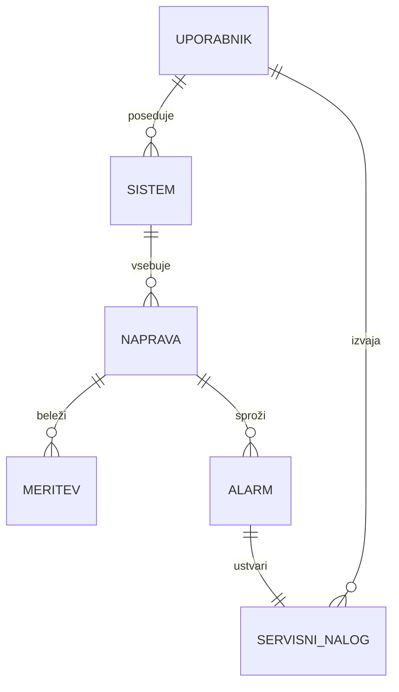

## Entitete
 
### Uporabnik
- Id, Ime, Priimek, Email, GeslaHash, Vloga (Lastnik/Serviser/Admin), Telefon
### Sistem (lokacija)
- Id, UporabnikId (lastnik), Naziv, Naslov, Lokacija (lat/lon), DatumNamestitve, NazivnaMoc
### Naprava
- Id, SistemId, Tip (Panel/Inverter), Proizvajalec, Model, SerijskaStevilka, DatumGarancije
### Meritev
- Id, NapraveId, CasovniZig, ProizvodnjaKwh, Temperatura, Napaka (bool)
### Alarm
- Id, NapraveId, Tip (npr. nizka_proizvodnja, izpad), Resnost, Status (Aktiven/Resen), CasZaznave
### ServisniNalog
- Id, AlarmId, SistemId, ServiserId, Status (Odprt/Dodeljen/VObdelavi/Zakljucen), Prioriteta, Opis, DatumOdprtja, DatumZakljucka
## Povezave
- Uporabnik (Lastnik) 1 — N Sistem
- Sistem 1 — N Naprava
- Naprava 1 — N Meritev
- Naprava 1 — N Alarm
- Alarm 1 — 1 ServisniNalog (alarm sproži največ en odprt nalog)
- Uporabnik (Serviser) 1 — N ServisniNalog
## Osnutek modela
 

