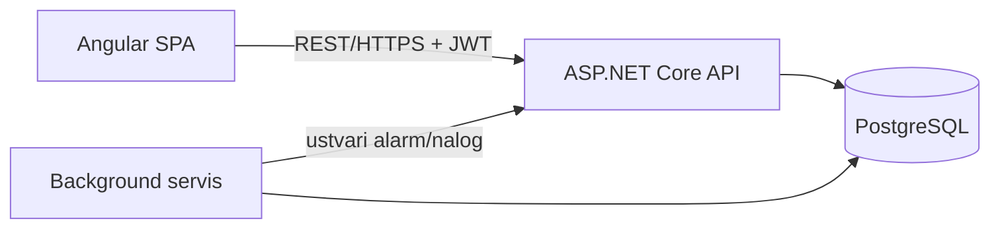

## Arhitektura
 
### Glavni deli sistema
- Odjemalec (Angular) - uporabniški vmesnik za vse tri vloge.
- Zaledni API (ASP.NET Core Web API) - poslovna logika, avtentikacija, REST endpointi.
- Background servis za obdelavo meritev - periodično preverja meritve, računa odstopanja, sproža alarme in servisne naloge.
- Podatkovna baza (PostgreSQL) - trajna shramba.
### Komunikacija med deli sistema
- Angular komunicira z API-jem prek REST/HTTPS (JSON).
- Background servis dostopa do iste baze kot API.
- Avtentikacija prek JWT žetonov, posredovanih v Authorization headerju.
### Podatkovna baza
- PostgreSQL, relacijska shema po modelu iz `03-podatkovni-model.md`.
- Meritve kot časovna vrsta (indeks po NapraveId + CasovniZig).
### Avtentikacija / upravljanje uporabnikov
- ASP.NET Core Identity za uporabnike, gesla in vloge.
- JWT (access + refresh token) za sejo na odjemalcu.
- Avtorizacija po vlogah (role-based) na nivoju API končnih točk.
### Lokalni zagon
- Docker Compose: zabojniki za API, Angular in PostgreSQL.
- `docker compose up` zažene celoten sistem lokalno.
### Diagram
 

 
## Tehnološki sklad
 
- Frontend: Angular, TypeScript, Angular Material
- Backend: ASP.NET Core Web API (C#), Entity Framework Core
- Podatkovna baza: PostgreSQL
- Avtentikacija: ASP.NET Core Identity + JWT
- Lokalni razvoj: Docker, Docker Compose
- Ostalo: background servis (.NET Hosted Service) za obdelavo meritev, AutoMapper, FluentValidation
## Arhitekturne odločitve
- PostgreSQL namesto NoSQL: podatki so močno relacijski (sistem - naprava - meritev - alarm - nalog), potrebne so povezave in konsistentnost.
- Ločen background servis za obdelavo meritev: zaznavanje anomalij je lahko časovno zahtevno in ne sme blokirati API klicev.
- JWT namesto sejnih piškotkov: SPA arhitektura, lažja skalabilnost, enostavna uporaba v Angular interceptorjih.
- Docker Compose za lokalni razvoj: enoten zagon vseh komponent.
