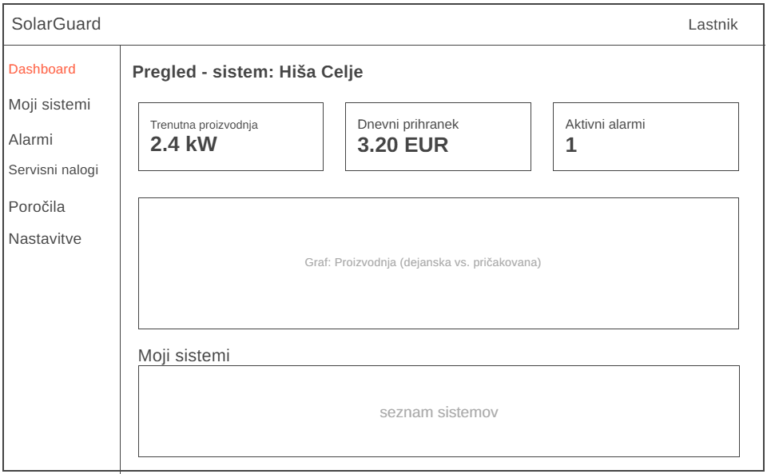
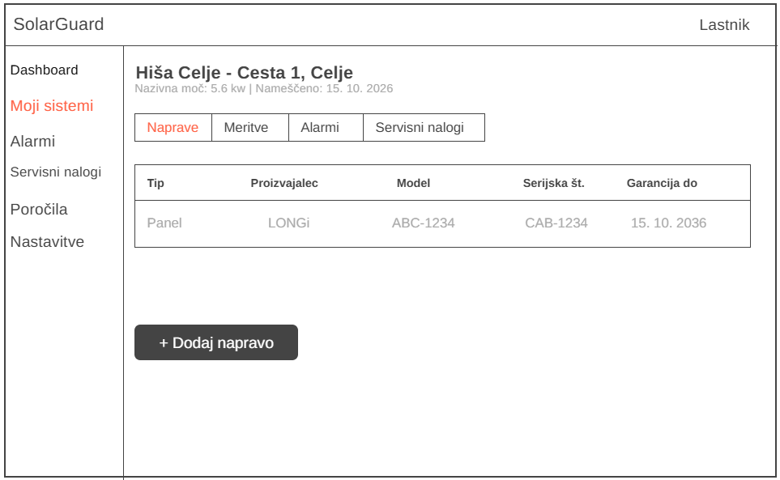
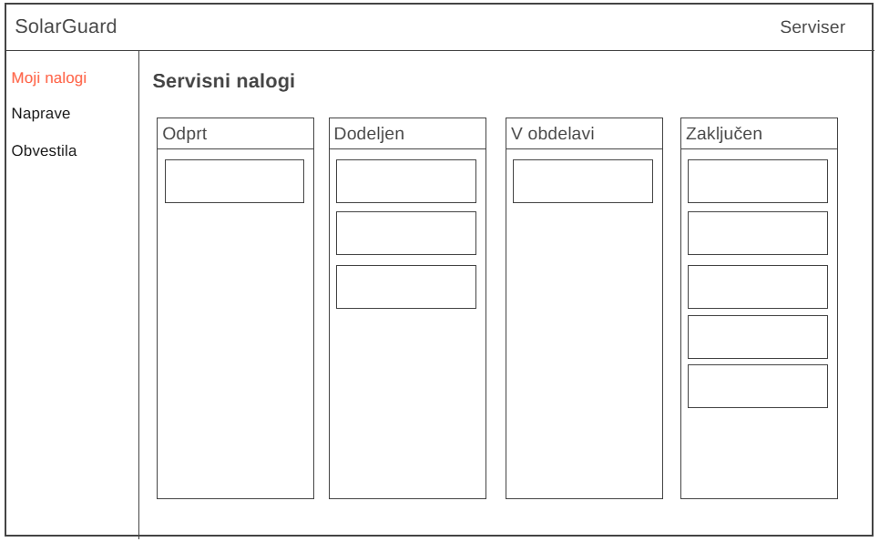
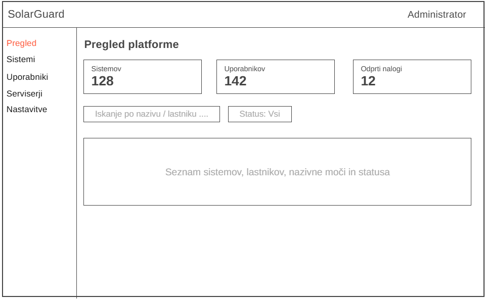

# Wireframes

Skice osnovnega izgleda aplikacije za tri uporabniške vloge.

## 1. Lastnik - Dashboard

Glavni pogled lastnika po prijavi: KPI-ji (trenutna proizvodnja, dnevni prihranek, število aktivnih alarmov), graf proizvodnje s preklopom obdobja (dan/teden/mesec/leto) ter seznam vseh sistemov, ki jih lastnik poseduje.

## 2. Lastnik - Detajl sistema (naprave)

Podroben pogled enega sistema z zavihki (Naprave, Meritve, Alarmi, Servisni nalogi). Prikazan je zavihek Naprave - tabela panelov/inverterjev s proizvajalcem, modelom, serijsko številko in datumom garancije, ter gumb za dodajanje nove naprave (CRUD).

## 3. Serviser - Servisni nalogi

Pogled serviserja v obliki kanban tabele s stolpci po statusu naloga (Odprt, Dodeljen, V obdelavi, Zaključen). Vsaka kartica predstavlja en servisni nalog z napravo in kratkim opisom težave - prikazuje potek funkcionalnosti sledenja statusu nalogov.

## 4. Admin - Pregled platforme

Administratorski pregled celotne platforme: KPI-ji (število sistemov, uporabnikov, odprtih nalogov), iskanje/filter po sistemih ter tabela vseh registriranih sistemov z lastnikom in statusom.
